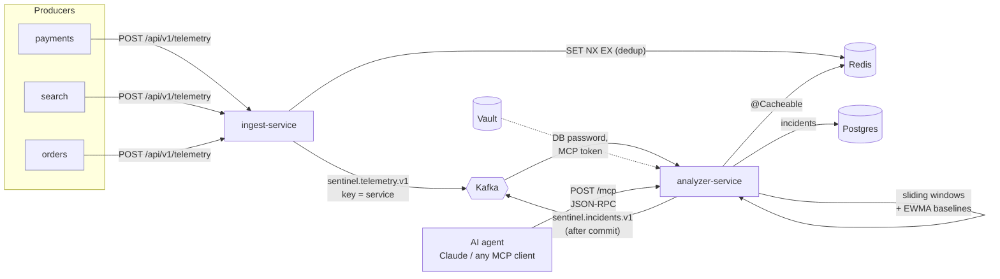

# SentinelOps

**Event-driven incident detection for microservices, with an MCP server so AI agents can triage what it finds.**

Services send request telemetry to SentinelOps. It streams the data through Kafka, detects error-rate spikes and latency regressions in real time, opens and auto-resolves incidents, and exposes them over the [Model Context Protocol](https://modelcontextprotocol.io). An agent such as Claude can then list incidents, read live service health, pull the relevant runbooks (retrieval for RAG) and acknowledge an incident with its diagnosis.

      

## Architecture



| Module | Responsibility |
|---|---|
| `common` | Shared event contracts (`TelemetryEvent`, `IncidentEvent`) and topic names |
| `ingest-service` | Validates telemetry, drops retried duplicates with Redis `SET NX EX`, publishes to Kafka keyed by service. Returns `202` only after Kafka acknowledges (`acks=all`, idempotent producer) |
| `analyzer-service` | Batch Kafka consumer, anomaly detector, incident lifecycle (Postgres + Flyway), Redis cache, REST API and MCP server. Reads secrets from Vault |

## How detection works

For every service the analyzer keeps a **1-minute sliding window** of requests and evaluates it every 5 seconds:

- **Error-rate spike**: 5xx share ≥ 20% → `HIGH`, ≥ 50% → `CRITICAL`.
- **Latency regression**: p95 > 2× the service's own **EWMA baseline** (and above a 250 ms floor). The baseline only learns from healthy windows, so a long regression can't teach the detector that slow is normal.
- Services with fewer than 20 requests in the window aren't judged, so low traffic doesn't cause noisy alerts.
- An incident **opens** on the first anomalous evaluation, updates its peaks while it lasts, and **auto-resolves** after 2 consecutive healthy evaluations, which prevents flapping.
- Lifecycle events go to `sentinel.incidents.v1` through a `@TransactionalEventListener(AFTER_COMMIT)`, so downstream notifiers never hear about a rolled-back incident.

**Why it scales horizontally:** telemetry is partitioned by service name, so each service's window lives on exactly one analyzer replica, and replicas share no state. Ingest is stateless and autoscales on CPU. Dedup is in Redis, so it holds across ingest replicas.

## MCP tools for AI agents

`POST /mcp` implements MCP's Streamable HTTP transport: `initialize` with version negotiation, `ping`, `tools/list` and `tools/call`.

| Tool | What it does |
|---|---|
| `list_incidents` | Active (or filtered) incidents, newest first |
| `get_incident` | Full incident plus the top matching runbooks (BM25 retrieval) |
| `get_service_health` | Live window stats: requests, error rate, p50/p95/p99, learned baseline |
| `search_runbooks` / `get_runbook` | Retrieval over the team's remediation runbooks |
| `acknowledge_incident` | Take ownership and record the diagnosis (state-changing) |

Tool failures come back as `isError: true` results the model can correct, not as protocol errors. If `sentinel.mcp.token` is set (from Vault), the endpoint requires a bearer token, checked in constant time.

Connect Claude Code to a running stack:

```bash
claude mcp add --transport http sentinelops http://localhost:8082/mcp --header "Authorization: Bearer local-mcp-token"
```

Then ask: *"What's broken right now, and what does the runbook say to do?"*

## Run it

**Full stack** (Kafka KRaft, Redis, Postgres, Vault and both services):

```bash
docker compose up --build
```

```bash
python3 scripts/simulate.py          # healthy traffic, then a payments outage at ~30s
```

```bash
curl -s localhost:8082/api/v1/incidents | jq
```

```bash
curl -s localhost:8082/api/v1/services/health | jq
```

**Tests** (no Docker needed; uses embedded Kafka and H2):

```bash
mvn verify
```

| Test | Covers |
|---|---|
| `EndToEndTest` | Telemetry on Kafka → incident opened → event published after commit → agent lists, inspects and acknowledges over MCP → traffic recovers → auto-resolve |
| `AnomalyDetectorTest` | Thresholds, baseline learning, baseline not poisoned by a regression, latency floor, late and clock-skewed events |
| `McpControllerTest` | Version negotiation, notifications, tool listing, tool errors vs protocol errors, auth |
| `TelemetryControllerTest` | Validation, batch dedup, `503` when Kafka is down |
| `RunbookIndexTest` | Retrieval ranking |

## Deploy to Kubernetes

```bash
kubectl apply -k deploy/k8s
```

- Readiness and liveness probes on the actuator health groups, non-root containers with a read-only root filesystem, resource requests and limits
- `HorizontalPodAutoscaler` for ingest, and a `PodDisruptionBudget` for the analyzer
- Analyzer pods log in to Vault with their **Kubernetes service account** (`deploy/vault/k8s-auth.sh`) and can read only `secret/analyzer-service`. Nothing sensitive is in the ConfigMap or the image
- Prometheus metrics at `/actuator/prometheus`: `sentinel.ingest.published`, `sentinel.analyzer.consumed`, `sentinel.incidents.opened{type}`, …

## Design notes and trade-offs

- **In-memory windows:** fast and simple, but a consumer-group rebalance resets the moved services' windows. They refill within one window length. Kafka Streams state stores would make this durable at the cost of complexity.
- **Lexical retrieval:** runbooks are ranked with BM25 in-process, which is plenty for a few hundred documents. `RunbookIndex` is the single place to swap in embeddings and a vector store.
- **Stateless MCP:** the server never initiates messages, so it answers JSON only and doesn't hold sessions. Any replica can serve any request behind a plain load balancer.

## Tech stack

Java 21 · Spring Boot 3.5 · Spring Kafka · Spring Data JPA · Flyway · PostgreSQL · Redis · Spring Cloud Vault · Micrometer/Prometheus · Docker · Kubernetes · GitHub Actions · JUnit 5 · Embedded Kafka · Model Context Protocol
